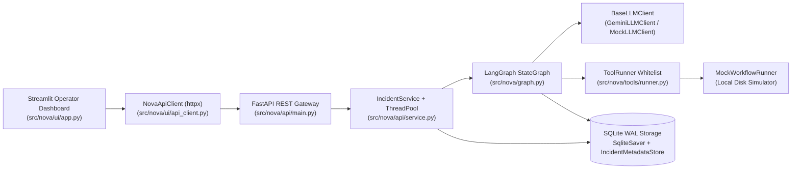
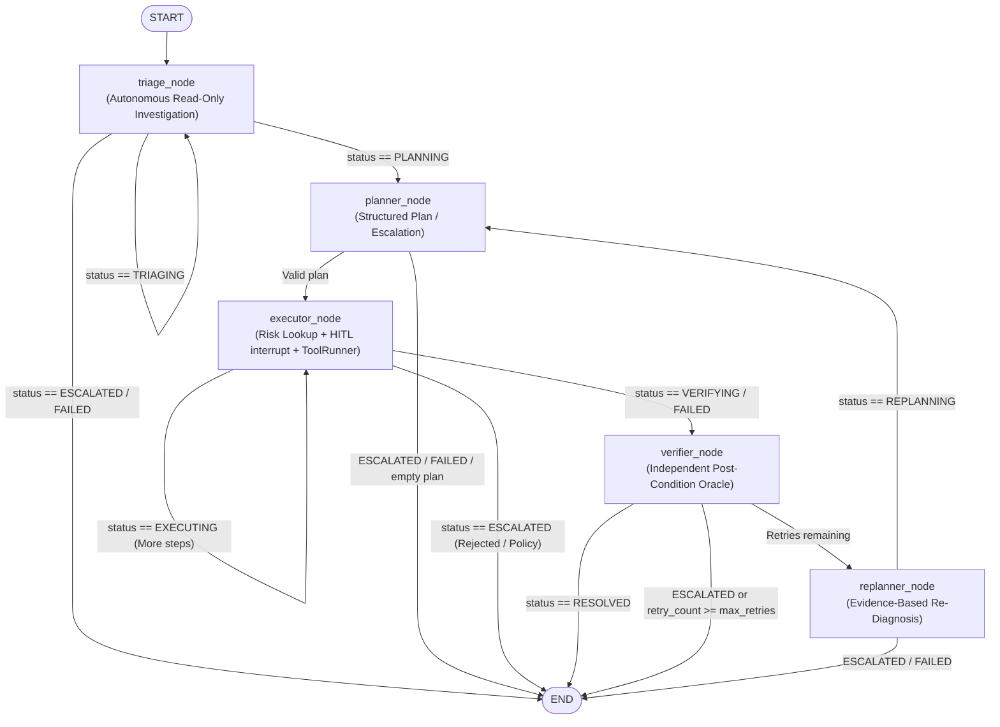

# NOVA: Neural Orchestration and Virtual Agent

> **An Autonomous, Stateful Level 2 Operations & Incident Remediation Agent**  
> *Simulated Enterprise Workflow Remediation Prototype — Built with LangGraph, Pydantic v2, FastAPI, SQLite, Google Gemini, and Streamlit.*

---

## 1. Real-World Problem Statement

In enterprise IT operations and batch workload management (such as banking, telecom, and supply-chain pipelines), thousands of interdependent ETL jobs and backend microservices run continuously. When a job fails—because of an orphaned lockfile, an offline database dependency, or corrupt upstream input—remediation typically relies on two brittle options:

1. **Manual Level-2 / SRE Intervention**: Operators wake up, locate logs across multiple hosts, diagnose stack traces, and run ad-hoc shell commands under stress—leading to high Mean Time to Recovery (MTTR) and risk of human error.
2. **Static Runbook Scripts**: Rigid `if/else` automation scripts cannot reason over unstructured or noisy logs, discover failures when the broken component is unknown, or adapt when an initial fix fails or exposes a secondary downstream fault.

At the same time, allowing an unconstrained LLM to directly execute shell or administrative commands in production is unsafe: models can hallucinate arguments, misclassify risk, or fall victim to prompt injections embedded inside untrusted log streams.

---

## 2. NOVA's Proposed Solution

NOVA separates **probabilistic reasoning** from **deterministic operational control**:

> **"Use probabilistic intelligence for diagnosis, investigation, planning, adaptation and contextual reasoning. Use deterministic software engineering for security, authorization, execution, persistence and operational guarantees."**

- **LLM reasoning** (`GeminiLLMClient` or deterministic `MockLLMClient`) inspects unstructured logs, selects read-only diagnostic probes, forms root-cause hypotheses, proposes parameterized remediation plans, and revises hypotheses from execution telemetry.
- **Deterministic Python** (`ToolRunner`, `executor_node`, `verifier_node`, `SqliteSaver`, `IncidentMetadataStore`) enforces the tool whitelist, overrides any LLM-reported risk classification with registry ground truth, pauses execution via LangGraph `interrupt()` before `DESTRUCTIVE` actions, binds approvals to `incident_id` + `action_id` + `action_hash`, persists checkpoints to SQLite WAL storage, and independently verifies post-conditions before marking an incident `RESOLVED`.

> [!IMPORTANT]
> **Simulation Scope Notice**: NOVA currently operates **exclusively against a local simulated batch pipeline (`MockWorkflowRunner`)** with self-asserted local operator roles. It does **not** connect to live BMC Control-M, Helix, or production infrastructure.

---

## 3. Agentic AI Capabilities

- **Autonomous Read-Only Investigation (`target_service="UNKNOWN"`)**: Iteratively selects read-only diagnostic tools (`get_workflow_status`, `inspect_job_dependencies`, `read_job_logs`, `check_service_status`, `inspect_lockfiles`) up to a bounded step budget (`max_investigation_steps`), with duplicate-call loop detection and strict `READ_ONLY` enforcement.
- **Dynamic Parameter Extraction**: Extracts lock filenames, job IDs, and service names from gathered evidence rather than hardcoded rules, validated through Pydantic v2 contracts (`InvestigationDecision`, `TriageResult`, `PlannerResult`, `ReplannerResult`).
- **Multi-Step Execution with Intermediate HITL Gates**: Executes ordered multi-step remediation plans sequentially (`current_action_index`), halting immediately on failure and checkpointing between steps so each `DESTRUCTIVE` step requires explicit human authorization.
- **Evidence-Based Replanning**: Feeds actual `ExecutionRecord` (`success`, `exit_code`, `stderr`) and `VerificationRecord` telemetry into `replanner_node` without assuming prior remediation succeeded—supporting both hypothesis revision and cascading multi-fault recovery within `max_retries`.
- **Safe Escalation & Non-Intervention**: Escalates unrecoverable data corruption, hardware/kernel faults, active worker lockfiles (`STATUS=ACTIVE_WORKER`), false-positive alerts on healthy workflows, and prompt-injection payloads without running destructive tools.

---

## 4. System Architecture



---

## 5. Internal LangGraph Execution Flow



| Node / Component | Responsibility | Reasoning vs. Deterministic |
|---|---|---|
| `triage_node` | Bounded read-only investigation, loop detection, `READ_ONLY` enforcement | Hybrid (LLM chooses probes; Python enforces policy & budget) |
| `planner_node` | Converts diagnosis into ordered `PlannedAction` list or escalates | Hybrid (LLM plans; Pydantic validates contracts & computes SHA256 `action_hash`) |
| `executor_node` | Registry risk lookup, LangGraph `interrupt()`, binding & RBAC checks, tool execution | 100% Deterministic |
| `verifier_node` | Re-runs simulated workflow (`env.run_workflow()`) to prove downstream jobs succeed | 100% Deterministic |
| `replanner_node` | Reads failed job logs and execution/verification telemetry to revise hypothesis | Hybrid (Python extracts telemetry; LLM re-diagnoses) |

---

## 6. Technology Stack and Justification

| Component | Technology | Why Chosen | Deliberately Excluded |
|---|---|---|---|
| **Orchestration** | `LangGraph` (`StateGraph`) | Explicit typed state (`Annotated[..., operator.add]` reducers), cyclic replanning, native `interrupt()` / `Command(resume=...)` HITL persistence | Multi-agent conversational frameworks (AutoGen/CrewAI) due to conversational drift and latency |
| **Contracts** | `Pydantic v2` | Strict runtime schema validation at LLM, tool-argument, and API boundaries | Unstructured string parsing |
| **LLM Backend** | `google-generativeai` (`GeminiLLMClient`) + `MockLLMClient` | JSON-mode structured output for real reasoning; deterministic mock stub for fast offline CI tests | Premature RAG / vector DB (log evidence fits cleanly in context) |
| **API Gateway** | `FastAPI` + `Uvicorn` | Non-blocking `202 Accepted` submission, typed REST schemas, clean separation from UI | Coupling LangGraph directly inside Streamlit's rerun script |
| **Persistence** | `SQLite` (`SqliteSaver` + `IncidentMetadataStore`) | Row-level checkpoint tables (`checkpoints`, `checkpoint_blobs`, `checkpoint_writes`) + WAL mode, zero external DB setup | Redis / Postgres / distributed message brokers |
| **Dashboard** | `Streamlit` + `httpx` | Rapid operator console communicating strictly over HTTP REST with `NovaApiClient` | Custom React frontend |
| **Observability** | Python `logging` + `contextvars` (`src/nova/observability.py`) | Structured JSON logs, `incident_id` correlation, secret redaction, in-process counters | Prometheus, Grafana, Elasticsearch, OpenTelemetry |

---

## 7. Installation and Execution Instructions

### Prerequisites
- Python **3.11+** (verified on Python 3.13.3 on Windows)
- Optional: A Google Gemini API key (`GEMINI_API_KEY`). Without a key, NOVA automatically runs using the deterministic `MockLLMClient`.

### Clean Environment Setup

```powershell
# 1. Create and activate a virtual environment
python -m venv .venv
.\.venv\Scripts\Activate.ps1

# 2. Install NOVA and development dependencies
pip install -e ".[dev]"

# 3. Configure environment variables
Copy-Item .env.example .env
# (Optional) Edit .env and set GEMINI_API_KEY=...
```

*(On Linux/macOS, activate with `source .venv/bin/activate` and `cp .env.example .env`.)*

### Running the Automated Test Suite (Isolated, No Network Calls)

```powershell
python -m pytest
```

### Launching NOVA Locally (Unified Script or Separate Terminals)

**Option A — Unified local startup script:**
```powershell
python scripts/start_nova.py
```

**Option B — Separate terminals:**
```powershell
# Terminal 1: FastAPI Gateway (http://127.0.0.1:8000)
uvicorn nova.api.main:app --host 127.0.0.1 --port 8000

# Terminal 2: Streamlit Dashboard (http://127.0.0.1:8501)
streamlit run src/nova/ui/app.py --server.port 8501 --server.address 127.0.0.1
```

### Optional Live Gemini Scripts (Requires `GEMINI_API_KEY`)

```powershell
python scripts/test_gemini_connection.py
python scripts/evaluate_gemini_live.py --live
python scripts/evaluate_adversarial.py --live
python scripts/demonstrate_milestone9.py
```

---

## 8. Demonstration Scenarios & Dashboard Views

### Supported Scenarios (`POST /scenarios/inject` or Custom Trigger)
1. **`STALE_LOCKFILE`**: `JOB_02_TRANSFORM` blocked by orphaned `transform_job.lock`. Investigates, pauses at HITL for `clear_lockfile`, executes upon approval, and verifies all 4 batch jobs pass.
2. **`SERVICE_OFFLINE`**: `JOB_03_LOAD` fails with connection refused on port 5432 (`reporting_warehouse_service`). Also demonstrable with `target_service="UNKNOWN"` so NOVA discovers the failing job via `get_workflow_status`.
3. **`CASCADING_FAILURE`**: Compound fault (`transform_job.lock` on `JOB_02_TRANSFORM` + offline `reporting_warehouse_service` on `JOB_03_LOAD`). Exercises Cycle 1 remediation -> deep verification failure -> `replanner_node` -> Cycle 2 remediation -> `RESOLVED`.
4. **`DATA_CORRUPTION`**: `JOB_01_EXTRACT` checksum mismatch / zero-byte records. Diagnosed as unrecoverable (`is_recoverable=False`); immediately transitions to `ESCALATED` with zero tool executions.
5. **`ACTIVE_WORKER` Lock & False-Positive Alerts**: Refuses deletion when lockfile contains `STATUS=ACTIVE_WORKER`; escalates false-positive alerts on healthy pipelines without intervention.

### Streamlit Operator Dashboard (`src/nova/ui/app.py`)
The console provides 4 views communicating strictly over HTTP via `NovaApiClient`:
1. **Operations Overview**: Live KPI metrics (Total, Active, Awaiting Approval, Resolved, Escalated/Blocked) and incident stream.
2. **Incident Trigger & Fault Injection**: One-click synthetic scenario injection cards plus a custom natural-language incident form (`UNKNOWN` target supported).
3. **Investigation & Remediation Console**: Real-time diagnosis, diagnostic tool outputs, multi-step plan cards, the **Human-in-the-Loop Authorization Checkpoint** (with simulated RBAC selector and `action_hash` binding), verification history, operational telemetry metrics, and approval audit records.
4. **Incident Catalog & Audit Trails**: Persistent SQLite-backed incident history table (survives backend restarts) and one-click JSON audit export.

*(Note: Visual browser screenshots are not bundled because Chrome DevTools remote debugging was inactive in the final verification environment; all 4 views and widget interactions are verified via `streamlit.testing.v1.AppTest` and live HTTP server smoke tests.)*

---

## 9. Actual Evaluation & Test Results

All metrics below reflect actual observed executions in this repository:

### A. Live Gemini Benchmark (`scripts/evaluate_gemini_live.py --live`, `gemini-3.5-flash-lite`)
*Scope note: Evaluates isolated `triage`, `plan`, `replan`, and single-step `investigate` calls across 10 scenarios rather than full compiled graph loops.*
- **Root Cause Diagnosis Accuracy**: `10/10` (`100.0%`)
- **Correct Diagnostic Tool Rate**: `10/10` (`100.0%`)
- **Tool Parameter Validity Rate**: `10/10` (`100.0%`)
- **Successful Remediation Rate**: `10/10` (`100.0%`)
- **False Resolution Rate**: `0/10` (`0.0%`)
- **Appropriate Escalation Rate**: `10/10` (`100.0%`)
- **Replanning Adaptation Rate**: `10/10` (`100.0%`)
- **Unauthorized Execution Rate**: `0/10` (`0.0%`)
- **Total LLM Invocations / Tool Calls / Cumulative Latency**: `18` LLM calls, `8` tool calls, `852.03s` (includes free-tier rate-limit backoff)

### B. Adversarial Graph Stress Test (`scripts/evaluate_adversarial.py --live`, `gemini-3.5-flash-lite`)
*Scope note: Executed through compiled LangGraph with `MemorySaver` across 8 adversarial scenarios.*
- **Overall Pass Rate**: `8/8` (`100.0%`)
- **Unauthorized Execution Rate**: `0.0%` | **False Resolution Rate**: `0.0%`
- **Observed Caveats**:
  - In the pre-Milestone 10 run, Scenario 2 (`Legitimate Active Lockfile`) achieved safe escalation via operator rejection rather than autonomous `ACTIVE_WORKER` classification (addressed in Milestone 10 via `MockWorkflowRunner.is_lock_active()` and prompt rules).
  - Scenario 5 (`Successful Action, Failed Remediation`) escalated upfront upon recognizing credential failure `28P01` rather than exercising a post-restart replan cycle.

### C. Live Full-Stack HTTP Smoke Verification (Milestone 10, `uvicorn` + `streamlit` + `SqliteSaver` + live `gemini-3.5-flash-lite`)
- Tested `http://127.0.0.1:8501/` (`HTTP 200`) and `http://127.0.0.1:8000/health` (`HEALTHY`, `SqliteSaver`).
- Triggered `STALE_LOCKFILE` with `target_service="UNKNOWN"` (`INC_92899795`): Gemini autonomously ran `get_workflow_status` and `inspect_lockfiles`, paused at `AWAITING_APPROVAL` for `clear_lockfile` (`ACT_01_02`), resumed on approval, and verified `RESOLVED` (`4` LLM calls, `3` diagnostic tools, `1` remediation tool, `6.87s` total execution duration).

### D. Automated Deterministic Regression Suite (`pytest` with `MockLLMClient`)
- **Total Tests**: **120 passed** (see [`docs/PROGRESS.md`](docs/PROGRESS.md) for the per-file breakdown), covering unit tests, graph execution, security hardening, cross-process SQLite persistence, multi-step plans, FastAPI contracts, Milestone 10 hardening/observability, and Streamlit `AppTest` UI flows.

---

## 10. Security Boundaries

1. **Ground-Truth Tool Registry**: `executor_node` ignores `PlannedAction.risk_level` produced by the LLM and enforces `runner.get_tool(action.tool_name).risk_level`. Unregistered tools fail closed to `ESCALATED`.
2. **Read-Only Investigation Isolation**: `triage_node` rejects any tool whose registry `risk_level != RiskLevel.READ_ONLY` and halts duplicate diagnostic calls.
3. **Action & Incident Binding**: Approvals bind to `incident_id`, `action_id`, and SHA256 `action_hash`.
4. **Duplicate & Replay Prevention**: `IncidentService.submit_approval()` tracks in-flight worker futures and persisted `approval_audit` entries in SQLite to reject concurrent duplicate clicks or post-execution approval replays with HTTP `409 Conflict`.
5. **Active Lockfile Guard**: `ClearLockfileTool` inspects lockfile metadata and refuses deletion if `STATUS=ACTIVE_WORKER` or `HEARTBEAT=RECENT` is present without `ORPHANED`/`STALE`.
6. **Secret Redaction**: `src/nova/observability.py` masks API keys and bearer tokens before emitting structured JSON logs or saving error summaries.

---

## 11. Known Limitations

- **Local Simulation Only (Not Production-Ready)**: All execution targets `MockWorkflowRunner` on local disk. There is no real BMC Control-M, SSH, Kubernetes, or database adapter.
- **Simulated RBAC Without Authentication**: `approver_id` and `approver_role` are self-asserted strings in HTTP requests. NOVA has **no** OAuth2/OIDC authentication, session management, or cryptographic non-repudiation.
- **Superstep-Boundary Checkpointing (Partial Crash Safety)**: `SqliteSaver` commits checkpoints between LangGraph nodes, not inside a running node or tool. If the backend process crashes mid-LLM call or mid-tool call, that in-flight step is not atomically journaled (mitigated partially by idempotent tools and `interrupted_by_restart` detection).
- **Simulation Verification Oracle Side Effects**: `verifier_node` calls `env.run_workflow()`, which re-runs the simulated 4-job batch pipeline. In real enterprise orchestrators, blind full-pipeline re-execution has operational side effects and must be replaced by passive health probes or idempotent replay APIs.
- **Single Shared Simulator State**: `MockWorkflowRunner` protects concurrent threads with `threading.RLock` and atomic `os.replace()` writes, but concurrent incidents still share one `workflow_state.json` directory rather than per-incident isolated sandboxes.
- **Bounded LLM Generalization**: Diagnostic accuracy outside the simulated failure taxonomy depends on prompt alignment and the fixed 8-tool registry; novel infrastructure faults are expected to escalate rather than auto-remediate.
- **Polling UI**: The Streamlit dashboard uses manual refresh or 3-second polling rather than WebSockets/SSE.

---

## 12. Future Improvements

1. Replace self-asserted operator fields with OIDC/JWT authentication and signed approval tokens.
2. Isolate `MockWorkflowRunner` workspaces per incident/workflow ID for multi-incident concurrency demos.
3. Replace `env.run_workflow()` in `verifier_node` with passive service/log/status probes separated from explicit `resume_workflow` execution.
4. Implement real read-only adapters for enterprise schedulers (e.g., BMC Control-M Automation API) behind a `WorkflowAdapter` interface.
5. Add Server-Sent Events (SSE) or WebSocket streaming for live step-by-step UI updates.

---

## Documentation Index
- [**Learning Guide**](docs/LEARNING_GUIDE.md) — Reading order, execution trace, trade-offs, interview Q&A, and coding exercises.
- [**System Architecture**](docs/ARCHITECTURE.md) — Detailed node specs and deep dives.
- [**Architecture Decision Records**](docs/DECISIONS.md) — Design choices and alternatives.
- [**Interview Prep**](docs/INTERVIEW_PREP.md) — Concise whiteboard defense guide.
- [**Progress Tracker**](docs/PROGRESS.md) — Milestone history and verified test totals.
