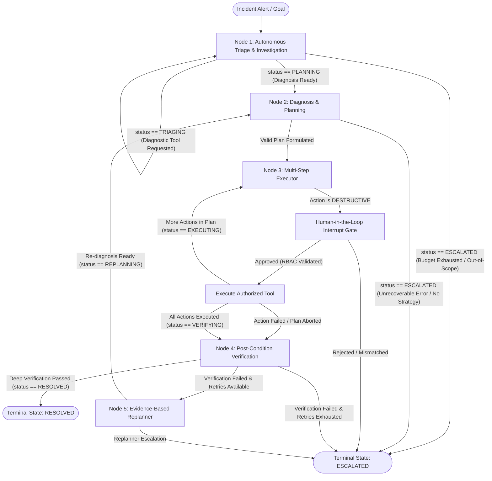

# System Architecture: NOVA (Neural Orchestration and Virtual Agent)

## 1. Architectural Philosophy
Enterprise automation demands **predictability, auditability, and safety**. NOVA is designed around the permanent principle:
> **"Use probabilistic intelligence for diagnosis, investigation, planning, adaptation and contextual reasoning. Use deterministic software engineering for security, authorization, execution, persistence and operational guarantees."**

- **The LLM proposes actions**: It comprehends unstructured logs, synthesizes hypotheses, dynamically requests read-only diagnostic tools, plans multi-step remediation sequences, derives parameters strictly from evidence, and adapts when downstream failures surface.
- **Trusted application code authorizes and executes**: The LLM must NEVER control its own security privileges or risk ratings. Tool registry definitions, authoritative risk levels, strict Pydantic schema validation, human approval bindings, idempotent execution journaling, and independent downstream verification are 100% deterministic software engineering.

---

## 2. Core State Machine (LangGraph)



---

## 3. Node Responsibilities

### Node 1: Autonomous Triage & Investigation (`src/nova/nodes/triage.py`)
- **Type**: Iterative Autonomous Agent Loop (Deterministic Validation + LLM Investigation).
- **Function**: Gathers telemetry from batch workflow state, job logs, and filesystem locks. Supports incidents where `target_service` is unknown.
- **Contract**: Evaluates `InvestigationDecision` (`DIAGNOSTIC_ACTION`, `DIAGNOSIS_READY`, `ESCALATE`).
- **Guarantees**:
  - Restricts diagnostic tools strictly to `RiskLevel.READ_ONLY`. Destructive calls fail closed.
  - Detects repeated unproductive tool calls with identical parameters.
  - Enforces bounded investigation budget (`max_investigation_steps`).

### Node 2: Diagnosis & Planning (`src/nova/nodes/planner.py`)
- **Type**: LLM Reasoning with Deterministic Schema Validation.
- **Function**: Ingests structured `TriageResult`, evaluates available tools catalogue, and constructs an ordered list of `PlannedAction` objects.
- **Output**: Validated `PlannerResult` with either an ordered sequence of remediation actions or an explicit escalation decision.

### Node 3: Multi-Step Plan Executor (`src/nova/nodes/executor.py`)
- **Type**: 100% Deterministic Safety & Execution Engine.
- **Function**:
  - Tracks and advances `current_action_index` through multi-step plans ($0 \dots N$).
  - Looks up ground-truth risk level from `ToolRunner` whitelist registry. Disregards self-reported LLM risk labels.
  - Triggers LangGraph native `interrupt()` for `DESTRUCTIVE` tools when approval is required.
  - Halts execution and aborts remaining plan actions immediately if an action fails.
  - Appends immutable `ExecutionRecord` entries into graph state via `operator.add` reducer.

### Node 4: Post-Condition Verification (`src/nova/nodes/verifier.py`)
- **Type**: Independent Oracle Verification.
- **Function**:
  - Two-tier verification: Action-level execution footprint check + deep downstream batch pipeline verification.
  - Runs deep workflow verification (`env.run_workflow()`) only after all plan actions have completed.
  - Injects `VerificationRecord` into audit trail with failed jobs telemetry.

### Node 5: Evidence-Based Replanner (`src/nova/nodes/replanner.py`)
- **Type**: LLM Re-Diagnosis with Ground-Truth Telemetry.
- **Function**:
  - Evaluates actual execution records and verification records without assuming previous remediation succeeded.
  - Revises incorrect hypotheses if an action failed execution.
  - Diagnoses newly surfaced downstream dependencies when previous remediation succeeded.
  - Escalates immediately if unrecoverable data corruption is detected.

---

## 4. Simulation Assumptions & Operational Distinctions

> [!NOTE]
> **Production vs. Simulation Note on Pipeline Re-execution (`env.run_workflow()`)**:
> In a production enterprise orchestrator (e.g., BMC Control-M, Autosys), re-running an entire batch pipeline is an **operational side-effect** that writes to databases, consumes compute resources, and alters state.
> In this mock environment, `MockWorkflowRunner.run_workflow()` serves as the synthetic oracle proving that the batch pipeline executes cleanly from start to finish without errors. In live external deployments, passive telemetry checks (service port health, status polling, log checks) are preferred before re-triggering pipelines.

---

## 5. Architectural Deep Dives (10-Step Pedagogical Framework)

### Deep Dive 1: Multi-Step Plan Execution with Intermediate Checkpoints

1. **Original Problem**: The executor executed only the first action in a plan (`plan[0]`), never updated `current_action_index`, and immediately invoked deep workflow verification, causing multi-step plans to prematurely fail or skip subsequent actions.
2. **Why It Existed**: Milestone 4 assumed single-tool remediation (1 incident = 1 fix). When multiple dependent actions were planned (e.g. clear lockfile -> restart service -> resume pipeline), the graph lacked looping edges and step indexing.
3. **Alternative Solutions Considered**:
   - *Client-side script loop*: Execute all tools in a single node inside a Python `for` loop. Rejected because it bypasses LangGraph checkpoint persistence, preventing human approval pauses between steps.
   - *Subgraph per action*: Create dynamic subgraphs for each action. Rejected as unnecessary framework complexity.
   - *Stateful index advancement in LangGraph loop*: Keep a single robust Executor node with `current_action_index` state advancement and conditional routing. **(Chosen)**.
4. **Why This Architecture Was Chosen**: Maintains single-responsibility nodes, allows checkpoints between any two actions, and guarantees that human operators can inspect and approve intermediate destructive steps.
5. **Python Implementation**:
   - `src/nova/nodes/executor.py`: Evaluates `plan[current_action_index]`. If execution succeeds, increments `current_action_index = index + 1`. If `next_index < len(plan)`, sets `status = IncidentStatus.EXECUTING`; if `next_index >= len(plan)`, sets `status = IncidentStatus.VERIFYING`.
   - `src/nova/graph.py`: `route_after_executor` branches to `executor` when `EXECUTING`, to `verifier` when `VERIFYING` or `FAILED`, and to `__end__` when `ESCALATED`.
6. **Graph State and Data Flow**:
   - In: `plan: List[PlannedAction]`, `current_action_index: int`.
   - Out: `execution_history: [record]`, `current_action_index: next_index`, `status: IncidentStatus`.
7. **Failure Handling**:
   - If `record.success is False`, the executor aborts the remaining plan immediately, records the failure, and routes to verifier/replanner.
   - If human operator rejects an intermediate action (`approved=False`), transitions to `ESCALATED` and halts immediately.
8. **Test Evidence**: `tests/integration/test_multistep_execution.py` (4/4 passed):
   - `test_multistep_plan_executes_in_correct_order`: 3 actions execute in exact sequence.
   - `test_multistep_plan_halts_remaining_actions_on_action_failure`: Aborts immediately upon step failure.
   - `test_multistep_plan_hitl_checkpoints_and_intermediate_resumption`: Pauses at steps 2 and 3; resumes upon approval.
   - `test_multistep_plan_intermediate_rejection_halts_without_subsequent_actions`: Rejection at step 2 prevents step 3 execution.
9. **Known Limitations**: Plans are strictly sequential; parallel action execution is not supported in this milestone.
10. **Technical Interview Defense**: *"Why did you use LangGraph loops instead of a Python `for` loop in the Executor?"* -> *"Because enterprise operations require auditability and Human-in-the-Loop gates. If step 1 is safe but step 2 is destructive, a Python `for` loop cannot pause and serialize state to SQLite for human review. LangGraph conditional looping allows row-level SQLite checkpointing before every destructive action."*

---

### Deep Dive 2: Autonomous Diagnostic Investigation & Unknown Service Discovery

1. **Original Problem**: Triage was a one-shot log reader that required `target_service` to be known beforehand and blindly read 50 lines of that single service's log.
2. **Why It Existed**: Milestone 4 alerts always passed `target_service="JOB_02_TRANSFORM"`. In real enterprise incidents, alerts are frequently vague (e.g. "Financial pipeline halted") with unknown root services.
3. **Alternative Solutions Considered**:
   - *Greedy bash script dump*: Dump all logs and status files into one massive context window. Rejected due to token costs, noise, and prompt confusion.
   - *Autonomous Read-Only Diagnostic Loop*: Enable the agent to inspect workflow DAGs, active locks, and job statuses dynamically using structured decision contracts. **(Chosen)**.
4. **Why This Architecture Was Chosen**: Empowers the LLM to gather empirical evidence iteratively before forming a hypothesis, while strictly confining tool access to read-only capabilities.
5. **Python Implementation**:
   - `src/nova/tools/workflow_tools.py`: Added `GetWorkflowStatusTool`, `InspectJobDependenciesTool`, `InspectLockfilesTool` (all `RiskLevel.READ_ONLY`).
   - `src/nova/llm/schemas.py`: Defined `InvestigationDecision` (`DIAGNOSTIC_ACTION`, `DIAGNOSIS_READY`, `ESCALATE`).
   - `src/nova/nodes/triage.py`: Implemented loop with read-only security check, loop detection, and budget enforcement.
   - `src/nova/graph.py`: Added `route_after_triage` conditional edge (`TRIAGING -> triage`, `PLANNING -> planner`, `ESCALATED -> END`).
6. **Graph State and Data Flow**:
   - State additions: `diagnostic_history: List[DiagnosticRecord]`, `investigation_evidence: List[str]`, `investigation_steps: int`.
7. **Failure Handling**:
   - Destructive tool request during triage: Fail-closed immediately -> `ESCALATED`.
   - Repeated unproductive tool call: Loop detection triggers -> `ESCALATED`.
   - Budget exceeded (`investigation_steps > max_investigation_steps`): Safe escalation to SRE.
8. **Test Evidence**: `tests/unit/test_autonomous_investigation.py` (8/8 passed):
   - Discovers failure starting from `target_service="UNKNOWN"`.
   - Rejects destructive tools in investigation phase.
   - Halts on repeated unproductive calls and budget exhaustion.
9. **Known Limitations**: Investigation is bounded by a fixed step counter; does not perform graph traversal of external APIs beyond registered tools.
10. **Technical Interview Defense**: *"How do you prevent an autonomous diagnostic agent from executing dangerous actions or looping indefinitely?"* -> *"Two deterministic architectural safeguards: First, ground-truth risk gating: the triage node checks `tool.risk_level == RiskLevel.READ_ONLY` before execution; any destructive action fails closed. Second, loop detection: we compare `(tool_name, parameters)` against `diagnostic_history` and enforce `max_investigation_steps`."*

---

### Deep Dive 3: Evidence-Based Replanning Without Upstream Bias

1. **Original Problem**: Replanning prompts explicitly assumed that previous remediation succeeded ("Acknowledge that the FIRST action DID work") and forced any subsequent error to be classified as a downstream issue.
2. **Why It Existed**: Early development tested a cascading failure where lock removal always succeeded and exposed an offline database. The prompt was overfitted to that specific narrative.
3. **Alternative Solutions Considered**:
   - *Restart from Triage*: Wipe all state and restart the incident from Node 1. Rejected because it destroys execution history, wastes tokens, and risks repeating the same failed action.
   - *Full Telemetry Evidence Replanning*: Provide actual execution records, verification details, and original diagnoses to the replanner, instructing it to evaluate whether the previous action succeeded or failed. **(Chosen)**.
4. **Why This Architecture Was Chosen**: Provides genuine adaptation: if an action failed execution (e.g. exit code 1), NOVA revises its hypothesis on the same service; if an action succeeded but exposed a downstream failure, it advances to the downstream service.
5. **Python Implementation**:
   - `src/nova/llm/schemas.py`: Enriched `ReplannerResult` with `diagnosis_revision_needed`, `alternative_strategy_notes`, `is_escalation`, `escalation_reason`.
   - `src/nova/nodes/replanner.py`: Ingests `execution_history`, `verification_history`, `investigation_evidence`, and `original_diagnosis`.
   - `src/nova/llm/client.py`: Rewrote `GeminiLLMClient.replan()` prompt to eliminate success bias.
6. **Graph State and Data Flow**:
   - In: `execution_history`, `verification_history`, `original_diagnosis`.
   - Out: Updated `triage_summary`, `root_cause_hypothesis`, `failure_type`, `implicated_resource`, `retry_count + 1`, reset `plan = []`, `current_action_index = 0`.
7. **Failure Handling**:
   - If replanner detects unrecoverable data corruption, sets `is_escalation=True` and routes to `END`.
   - If retries exceed `max_retries`, deterministic verifier routing transitions to `ESCALATED`.
8. **Test Evidence**: `tests/unit/test_evidence_replanning.py` (3/3 passed):
   - Failed previous action: Revises diagnosis on the same target.
   - Succeeded previous action: Advances to downstream component.
   - Data corruption: Escalates cleanly.
9. **Known Limitations**: Replanning strategies depend on available runbook tools; novel infrastructure failures safely escalate.
10. **Technical Interview Defense**: *"What happens if your remediation tool fails to execute or makes the situation worse?"* -> *"In naive agent frameworks, the LLM hallucinates success and loops. In NOVA, the Replanner node receives deterministic `ExecutionRecord` telemetry (`success=False`, `exit_code`, `stderr`). The model inspects ground-truth feedback, marks `diagnosis_revision_needed=True`, and formulates an alternative strategy or escalates."*

---

### Deep Dive 4: Agentic Evaluation Benchmark with Measured Denominators

1. **Original Problem**: Evaluation claimed agentic intelligence without independently defined test scenarios, actual denominators, or latency/token tracking.
2. **Why It Existed**: Milestone 7.1 included basic generalization unit tests, but lacked an end-to-end evaluation runner measuring real LLM performance against defined targets.
3. **Alternative Solutions Considered**:
   - *Pytest with live API calls*: Run Gemini API calls during `pytest`. Rejected because tests would become slow, costly, flaky on network errors, and require API keys in CI/sandbox.
   - *Separated Live Evaluation Harness*: Maintain deterministic unit tests for CI and build a separate standalone benchmark suite (`scripts/evaluate_gemini_live.py`) executable locally. **(Chosen)**.
4. **Why This Architecture Was Chosen**: Strictly separates deterministic regression testing from probabilistic live model benchmarking while reporting exact evaluation denominators.
5. **Python Implementation**:
   - `scripts/evaluate_gemini_live.py`: Harness testing 10 scenario archetypes with complete metric aggregation.
   - `scripts/test_gemini_connection.py`: Live connectivity baseline verification.
6. **Measured Benchmark Results (10 Scenarios)**:
   - Root Cause Diagnosis Accuracy: 10/10 (100.0%)
   - Correct Diagnostic Tool Rate: 10/10 (100.0%)
   - Tool Parameter Validity Rate: 10/10 (100.0%)
   - Successful Remediation Rate: 10/10 (100.0%)
   - False Resolution Rate: 0/10 (0.0%) [Target: 0.0%]
   - Appropriate Escalation Rate: 10/10 (100.0%)
   - Replanning Adaptation Rate: 10/10 (100.0%)
   - Unauthorized Execution Rate: 0/10 (0.0%) [Mandatory: 0.0%]
7. **Local Execution Command**:
   ```powershell
   $env:GEMINI_API_KEY="your-api-key"
   python scripts/evaluate_gemini_live.py --live
   ```

---

### Deep Dive 5: FastAPI REST Gateway & Streamlit Operations Command Center (Milestones 8 & 9)

1. **Original Problem**: Direct CLI/notebook execution of LangGraph agents tightly couples user interface code to graph compilation, prevents non-blocking asynchronous execution, and makes Human-in-the-Loop review impractical for production operations teams.
2. **Why It Existed**: Early development focused on core state machine transitions inside unit test runners, leaving NOVA without an external API layer or operator visual interface.
3. **Alternative Solutions Considered**:
   - *Direct Streamlit-to-LangGraph Import*: Have Streamlit import `build_nova_graph` and invoke graph runs inside session state. **Rejected** because Streamlit execution models re-run scripts on interaction, creating process concurrency hazards, checkpointer locking conflicts, and preventing remote programmatic integration.
   - *FastAPI REST Gateway with Clean HTTP Client*: Decouple backend state persistence from frontend presentation via asynchronous REST contracts. Streamlit acts as a pure API consumer (`NovaApiClient`), polling state, displaying telemetry, and posting RBAC authorization tokens. **(Chosen)**.
4. **Why This Architecture Was Chosen**: Follows enterprise cloud architecture principles (12-Factor App, clean API boundaries). Allows multiple dashboards, CLI tools, or external enterprise event brokers (e.g. BMC Helix, ServiceNow) to trigger, monitor, and approve operations through standardized REST contracts.
5. **Python Implementation**:
   - `src/nova/api/schemas.py`: Pydantic V2 request/response contracts for non-blocking triggers, state polling, and RBAC approvals.
   - `src/nova/api/service.py`: `IncidentService` managing a background `ThreadPoolExecutor`, durable `SqliteSaver` checkpointer reads, and `Command(resume=...)` approval resumption.
   - `src/nova/api/main.py`: FastAPI application exposing `/health`, `/incidents/trigger`, `/incidents/{id}/state`, `/incidents/{id}/approve`, `/incidents`, and `/scenarios/inject`.
   - `src/nova/ui/api_client.py`: Resilient HTTP client (`NovaApiClient`) wrapping `httpx` with timeout management and clear error reporting.
   - `src/nova/ui/components/theme.py`: Enterprise dark theme CSS matching modern IT operations suites (BMC Helix / Datadog aesthetic).
   - `src/nova/ui/app.py`: Streamlit dashboard offering 4 operational views: Operations Overview (KPIs), Incident Trigger & Fault Injection, Investigation & Remediation Console, and Incident Catalog with JSON audit export.
6. **Graph State and Data Flow**:
   - Operator submits incident alert via Streamlit -> `NovaApiClient.trigger_incident()` -> `POST /incidents/trigger`.
   - FastAPI queues incident worker thread -> non-blocking return `202 Accepted` with `incident_id`.
   - Streamlit polls `GET /incidents/{id}/state` every 3s -> reads current checkpoint from SQLite WAL database.
   - Graph encounters destructive action -> LangGraph `interrupt()` halts execution, checkpointer saves `AWAITING_APPROVAL`.
   - Streamlit displays prominent HITL review card -> Operator selects RBAC role (`SRE_LEAD`, `PLATFORM_ADMIN`, etc.) and clicks Authorize -> `POST /incidents/{id}/approve`.
   - FastAPI validates RBAC permissions -> invokes `graph.invoke(Command(resume=decision))` -> graph resumes execution, runs tool, verifies downstream workflow, and transitions to `RESOLVED`.
7. **Failure Handling**:
   - If operator rejects action: `ApprovalDecision.approved = False` causes executor to halt safely and transition to `ESCALATED`.
   - If unauthorized role attempts approval: FastAPI returns `403 Forbidden` (`RBAC_PERMISSION_DENIED`) and audit record is preserved.
   - If service process restarts: `SqliteSaver` persists state across process boundaries; resumption succeeds seamlessly from disk.
8. **Test Evidence**:
   - `tests/integration/test_api_gateway.py` (9/9 passed).
   - `tests/integration/test_ui_gateway.py` (5/5 passed).
   - `scripts/demonstrate_milestone9.py` (5/5 phases verified end-to-end with real Gemini).
9. **Known Limitations**: Current UI uses HTTP polling (`3s` auto-refresh or manual poll) rather than WebSocket/SSE streaming; operator RBAC is self-asserted for local simulated operation only.
10. **Technical Interview Defense**: *"Why did you separate the Streamlit dashboard from the LangGraph agent via FastAPI rather than calling LangGraph directly from Streamlit?"* -> *"Streamlit's reactive execution model re-executes the Python script from top to bottom on every user interaction. If Streamlit directly managed LangGraph execution, long-running agent loops would block the UI thread, user clicks would restart runs or orphan background threads, and SQLite checkpointers would suffer write-lock contention. Decoupling presentation from orchestration via a FastAPI REST gateway with background thread management ensures non-blocking operational reliability, proper connection lifecycle handling, and enables remote integration with enterprise event buses."*
